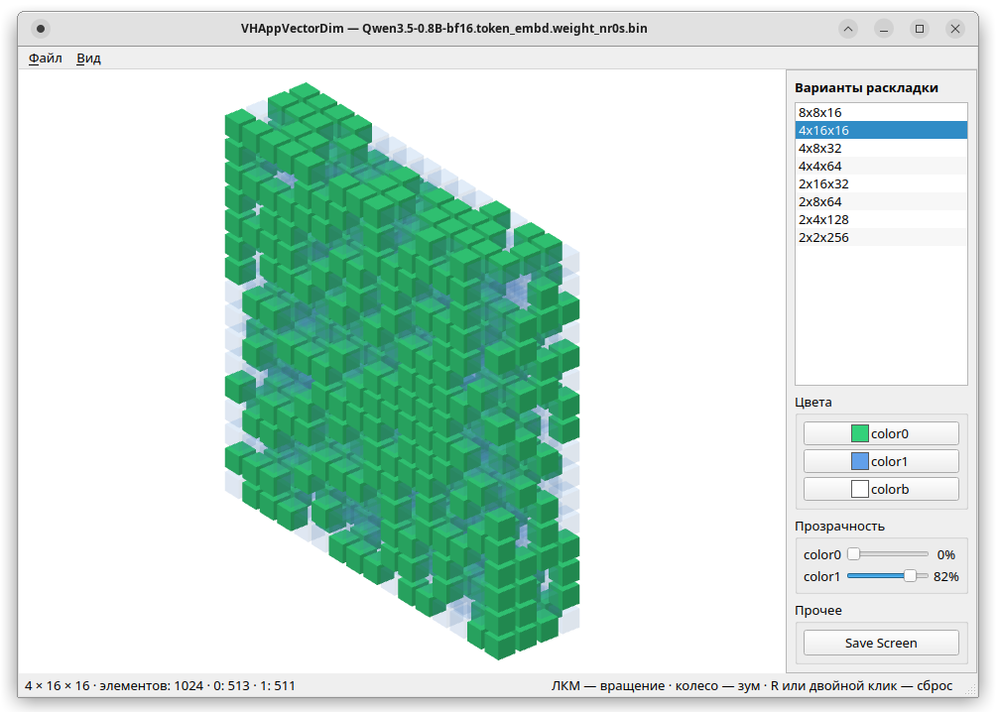

# VHAppVectorDim


## Description

`vhappvectordim` is a data vector visualization program. It takes a binary
file whose every byte is `0` or `1`, lays the array out into an `L × W × H`
rectangular cuboid and displays it in an isometric 3D scene rendered with
Qt6/OpenGL.




## Command Line

Command line parameters:

| Parameter | Required | Description |
|---|---|---|
| `file` | yes | Path to a binary file with `0/1` data. |
| `--help`, `-h` | no | Show help and exit. |
| `--version`, `-v` | no | Show version and exit. |

Example run:

```bash
./build/vhappvectordim data/test.bin
```

Without an argument, on a file read error, on an invalid byte or when no valid
layout exists, the program prints an error message and exits with code `1`.

## External Dependencies

**There are no git submodules.** The `src/extmods` directory is not used.

The only external dependency is Qt 6.4+ with the `Widgets`, `OpenGLWidgets`
and `OpenGL` components; it is linked through CMake. No other third-party
libraries are used.

## Build

Build instructions are available in [docs/build.md](docs/build.md).

## Run

```bash
./scripts/run_test.sh
./scripts/run_qwen.sh
./scripts/run_example.sh data/test.bin
```

The `scripts/run_example.sh` script builds the project first if needed.

## Test Data

| File | Size | Layout |
|---|---:|---|
| `data/test.bin` | 8 bytes | `2 × 2 × 2` |
| `data/Qwen3.5-0.8B-bf16.token_embd.weight_nr0s.bin` | 1024 bytes | `8 × 8 × 16` |

## Controls

| Action | Result |
|---|---|
| Left mouse button + drag | rotate the camera |
| Mouse wheel | zoom |
| `R` or double click | reset the camera |
| `color0` / `color1` | pick the color of the corresponding cube type |
| `colorb` | pick the 3D scene background color (white by default) |
| `wdgTrans0` / `wdgTrans1` sliders | separate transparency for the `0` and `1` cubes |
| `Save Screen` | save the 3D scene image as JPEG |

## Project Structure

```text
README.md     project description
LICENSE       MIT license
src/          core sources: main.cpp, CubeLayout.*, FileValidator.*
src/gui/      GUI: CubeView.*, CubeVisualizer.*
docs/         architecture and class descriptions, build instructions
scripts/      build and run scripts (build, run_test, run_qwen, run_example)
data/         test binary files
```

## Documentation

- [docs/architecture.md](docs/architecture.md) — architecture and data flow.
- [docs/build.md](docs/build.md) — building and running.
- [docs/CubeLayout.md](docs/CubeLayout.md) — array layout.
- [docs/FileValidator.md](docs/FileValidator.md) — file loading and validation.
- [docs/CubeView.md](docs/CubeView.md) — 3D scene.
- [docs/CubeVisualizer.md](docs/CubeVisualizer.md) — main window and control panel.


## Model credits

- [Qwen/Qwen3.5-0.8B](https://huggingface.co/Qwen/Qwen3.5-0.8B) — used weight layer(s).
- License: [Apache License 2.0](https://www.apache.org/licenses/LICENSE-2.0).
- Modifications: extracted/reused specific layer weights for visualization.


## License

This project is distributed under the MIT license. See [LICENSE](LICENSE).

Author: Viktor Glebov / V01G04A81

Copyright 2026 V01G04A81
